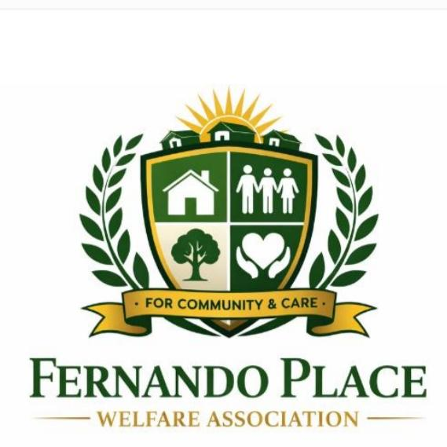

  

# Fernando Place Welfare Association

This repository contains the source code for the official **Fernando Place Welfare Association** webpage.

The purpose of this project is to provide residents with clear, accessible, and transparent information regarding:

- Welfare account updates  
- Project progress (including Gate Renovation 2026)  
- Community notices  
- Committee details and contact information  

The website is maintained to ensure openness, clarity, and easy access to all welfare‑related updates for Fernando Place residents.

---

## Contact

For welfare‑related queries or updates, please email:

**fernandoplaceassociation@gmail.com**

